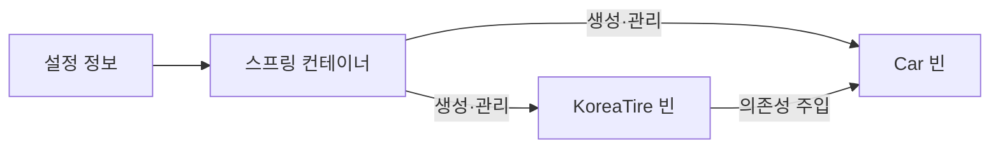

# 5주차

## 범위

7장. 스프링 삼각형과 설정 정보

## 1. IoC (제어의 역전)

> 1-1 ~ 1-2는 책의 내용이 부족하다고 판단하여 AI에 추가 질문을 통해 정리한 내용.

### 1-1. IoC와 DI는 어떻게 다를까?

IoC는 *Inversion of Control*, 제어의 역전이다. 이 장에서는 **의존 객체의 생성과 연결을 누가 주도하는가**에 집중하면 된다.

```text
직접 생성: Car가 사용할 타이어를 직접 결정하고 생성
수동 DI:  main 같은 외부 코드가 타이어를 만들어 Car에 전달
스프링 DI: 설정 정보를 바탕으로 컨테이너가 객체를 만들고 연결
```

**IoC는 제어권을 외부에 맡기는 큰 원리이고, DI는 그 원리를 실현하는 구체적인 방식 중 하나다.** 두 용어는 관련 있지만 완전히 같은 뜻은 아니다. [Spring의 IoC와 DI 정의](https://docs.spring.io/spring-framework/reference/core/beans/introduction.html)

### 1-2. 컨테이너, 빈, 설정 정보

| 용어                 | 뜻                                                        | 자동차 예제                               |
| -------------------- | --------------------------------------------------------- | ----------------------------------------- |
| 스프링 컨테이너      | 객체를 생성·연결하고 생명주기를 관리하는 주체             | 조립 담당자                               |
| 빈(Bean)             | 스프링 컨테이너가 관리하는 객체                           | 관리 대상으로 등록된 자동차와 타이어      |
| 설정 정보            | 어떤 객체를 만들고 어떻게 연결할지 알려 주는 정보         | 자동차에 한국 타이어를 넣으라는 설명서    |
| `ApplicationContext` | 보통 애플리케이션에서 사용하는 스프링 컨테이너 인터페이스 | 설정을 읽고 빈을 제공하는 컨테이너의 창구 |

컨테이너는 설정 정보를 읽어 빈을 구성한다. 설정 정보는 XML, 자바 설정 클래스, 애너테이션 등으로 표현할 수 있다.



### 1-3. DI (Dependency Injection, 의존성 주입)

- **객체가 자신이 사용할 부품을 직접 만들지 않고, 외부에서 주입받아 사용하는 방식**

### 1-4. 생성자를 통한 DI

- 객체를 만들 때, 생성자를 통해 의존성을 주입하는 방식.
- 필수 의존성에는 생성자 주입을 우선 고려할 것.

```java
interface CoffeeBean {
  String name();
}
class Yirgacheffe implements CoffeeBean {
  String name() { return "에티오피아 예가체프"; }
}
class Supremo implements CoffeeBean {
  String name() { return "콜롬비아 수프리모"; }
}
```

#### DI 미적용

- 객체 내부에서 의존성 직접 생성. 추상화가 아닌 구체적인 클래스에 직접 의존하게 됨. -> 의존 역전 원칙(DIP) 위반
- 원두를 변경하려면 `CoffeeMachine` 내부 코드를 직접 수정해야 함. -> 개방-폐쇄 원칙(OCP) 위반
  - 새로운 구현(원두)을 추가하려 할 때, 인터페이스 구현체를 새로 만드는 것에 그치지 않고, `CoffeeMachine` 내부 생성 코드까지 직접 수정.
  - 확장하기 위해 기존 코드를 뜯어고쳐야 함.

```java
class CoffeeMachine {
  CoffeeBean coffeeBean;

  public CoffeeMachine() {
    coffeeBean = new Supremo();
  }
}
```

#### DI 적용

- 외부에서 생성 후 전달.

```java
class CoffeeMachine {
  CoffeeBean bean;
  
  public CoffeeMachine(CoffeeBean bean) {
    this.bean = bean;
  }
}
```

##### 사용하는 이유

1. 결합도 감소
   - 구체적인 구현 대신 인터페이스에 의존. 부품을 교체해도 기존 비즈니스 로직을 건드릴 필요 X
2. 코드 재사용성 및 유지보수 향상
   - 클래스마다 맡은 역할이 명확해지고, 설정이나 조립을 한 곳에서 관리할 수 있음.


### 1-5. 속성을 통한 DI

- 객체를 먼저 생성한 뒤, `setter` 메서드를 통해 외부에서 의존성 주입하는 방식.
- 선택적 의존성에 권장.

```java
class CoffeeMachine {
  CoffeeBean bean;
  
  public void setCoffeeBean(CoffeeBean bean) {
    this.bean = bean;
  }
  
  public String getCoffeeBeanName() {
    return bean.name();
  }
}
```

```java
class Main {
  public static void main(String[] args) {
    CoffeeMachine machine = new CoffeeMachine();
    machine.setCoffeeBean(new Yirgacheffe());
  }
}
```

#### 사용하는 이유

```java
public class NotificationService {
    // 필수가 아닌 선택적 의존성
    private SmsSender smsSender;

    // 기본 생성자로 객체는 문제없이 생성 가능
    public NotificationService() {}

    // 선택적으로 주입받음
    public void setSmsSender(SmsSender smsSender) {
        this.smsSender = smsSender;
    }

    public void notifyUser(String message) {
        if (smsSender != null) {
            smsSender.send(message);
        } else {
            // 주입되지 않았을 때의 대체 로직
            System.out.println("기본 이메일 알림 전송: " + message);
        }
    }
}
```

1. 선택적 의존성 처리
   - 모든 의존성이 객체 동작에 필수적이지는 않음.
   - 필수 의존성이 아니라면 생성자에 나열해 강제할 필요 없이, 필요할 때만 setter 로 주입하거나, 주입되지 않았을 때 기본값으로 동작하게 설계 가능.
2. 런타임 시점의 동적 의존성 교체
   - 생성자 주입은 객체가 만들어질 때 의존성이 고정됨.
   - 반면 애플리케이션 실행 도중 정책이나 환경에 따라 부품을 갈아 끼워야 할 때(예: 실행 중 결제 게이트웨이 교체, 런타임 캐싱 전략 변경) `setter`를 호출해 손쉽게 교체할 수 있습니다.
3. 순환 참조 해결
   - A 클래스와 B 클래스가 서로를 필요로 하는 구조일 때.
   - 생성자 주입을 사용하면 애플리케이션 시작 시점에 에러가 발생.
   - 수정자 주입은 A와 B의 빈 껍데기 인스턴스를 먼저 각각 생성한 뒤, 생성 완료 후 서로에게 setter 로 꽂아주면 기술적으로 우회 가능.

### 1-6. @AutoWired

- 클래스 필드에 `@AutoWired` 어노테이션을 직접 붙여 주입받는 방식.
- 장점: 코드가 간결하고, 편리함.
- 단점:
  - **외부 조작 불가 (테스트 어려움):** `private` 필드이기 때문에 Spring 컨테이너 없이는 순수 단위 테스트에서 Mock 객체를 직접 주입하기 어려움.
  - **불변성 미보장:** `final` 키워드 사용 불가.
  - **프레임워크 종속성:** DI 프레임워크가 없으면 동작하지 않는 코드가 됨.

## 2. AOP (Aspect-Oriented Programming, 관점 지향 프로그래밍)

### 2-1. 핵심 관심사와 횡단 관심사

- **핵심 관심사**: 각 기능 고유의 핵심 업무 로직.(주문 처리, 회원가입, 결제 등...)
- **횡단 관심사**: 여러 기능에 걸쳐 **공통적으로** 필요한 부가 기능.(로깅, 실행시간 측정 등..)

- 관심사를 별도로 모듈화하고, 적용할 대상과 시점을 지정하는 방식.
  단순히 중복 코드를 함수로 뽑는 데서 더 나아가, 각 업무 코드가 공통 함수를 직접 호출하지 않아도 적용되게 함.
- AOP가 없으면 모든 메서드마다 코드를 직접 복사·붙여넣기 해야 함.

### 2-2. AOP 핵심 용어 정리

| **용어**       | **개념**                                                 | **비유**                                           |
| -------------- | -------------------------------------------------------- | -------------------------------------------------- |
| **Aspect**     | 흩어진 부가 기능들을 하나로 묶은 모듈 (부가 기능 정의체) | "보안팀", "기록팀"                                 |
| **Target**     | 부가 기능(Aspect)을 적용받는 실제 객체                   | 주문 서비스, 회원 서비스                           |
| **Advice**     | 실질적으로 수행할 부가 작업 내용 (언제 무엇을 할지)      | "메서드 실행 전 인증 체크", "실행 후 로그 남기기"  |
| **Join Point** | 부가 기능이 적용될 수 있는 실행 지점                     | 실행 가능한 모든 진입로                            |
| **Pointcut**   | 어떤 Join Point를 고를지 정하는 조건                     | "특정 패키지의 `Service` 클래스 메서드들에만 적용" |

### 2-3. 프록시 패턴

- 스프링 AOP는 프록시 패턴을 통해 동작함.

- 동작 방식:
  1. 클라이언트가 특정 서비스의 메서드를 호출.
  2. 실제 타깃 객체 대신 스프링이 중간에 심어둔 **프록시 객체**가 요청을 먼저 가로챔.
  3. 프록시가 공통 부가 로직(Advice)을 실행.
  4. 실제 타깃 객체의 원래 수행하려던 메서드 호출.
  5. 로직 수행이 끝나면 다시 프록시가 후처리 부가 로직을 수행하고 결과 반환.

## 3. PSA (Portable Service Abstraction, 일관성 있는 서비스 추상화)

- 환경이나 하위 기술 스택이 바뀌더라도, 애플리케이션 코드를 수정하지 않고 일관된 방식(추상화 계층)으로 기술을 사용할 수 있게 해주는 객체지향적 설계 원칙.

### 3-1. Spring 의 대표적인 PSA 사례

#### 스프링  트랜잭션(@Transactional)

- 데이터베이스 접근 기술마다 트랜잭션을 시작하고 커밋/롤백하는 API가 각기 다름.

  - **순수 JDBC:** `conn.setAutoCommit(false);` / `conn.commit();`
  - **JPA:** `em.getTransaction().begin();` / `em.getTransaction().commit();`
  - **MyBatis/Hibernate:** 각각 고유의 세션 및 트랜잭션 API 사용

- 만약 순수 기술에 의존했다면, JDBC에서 JPA로 전환할 때 서비스 레이어의 트랜잭션 코드를 전부 다시 짰어야 함. 스프링은 이를 `PlatformTransactionManager`라는 공통 추상 인터페이스로 감싸 둠.
  ```
  [서비스 레이어: @Transactional]
                │
                ▼
     [PlatformTransactionManager] (추상화 인터페이스)
                ▲
     ┌──────────┼──────────┐
     │          │          │
  [DataSource] [Jpa]    [Hibernate]
  Transaction  Transaction Transaction
    Manager      Manager     Manager
  ```

